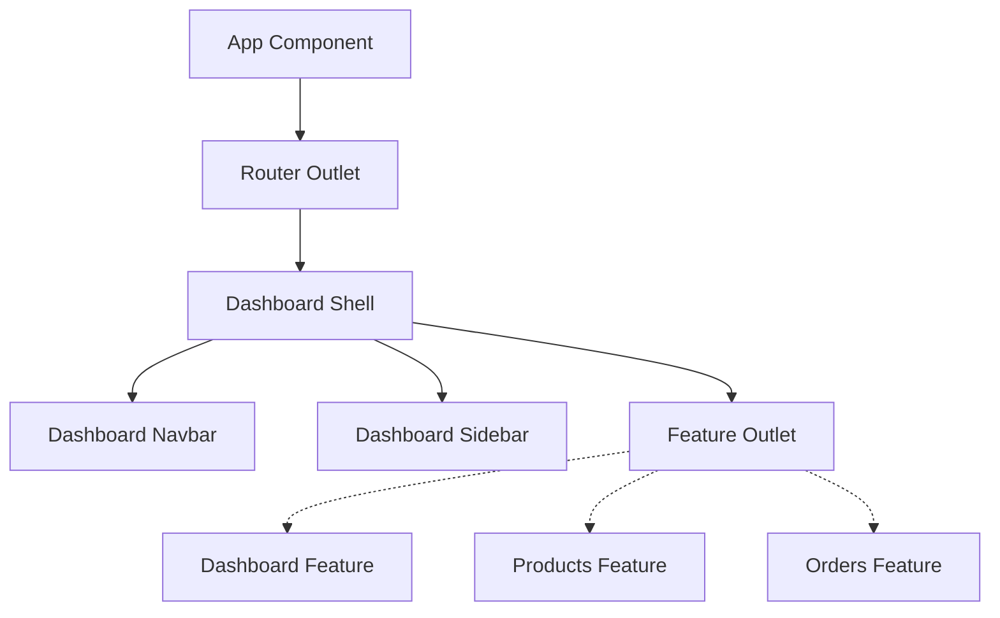

# Architecture Overview

This document describes the architectural patterns, project structure, and technical conventions of the **Invoria Web** application.

Folder index with per-doc/section anchors: [architecture/README.md](./README.md).

## 1. Architecture Style

Invoria Web follows a **Feature-Based Angular Architecture** using **Standalone Components**. The application is designed for high cohesion within features and low coupling between them.

### Key Principles

- **Self-Contained Features**: Each feature folder contains its own components, services, and models.
- **Standalone by Default**: All components are standalone, eliminating the need for `NgModules`.
- **Reactive State**: State is signals-first (page-local `signal`/`computed`/`rxResource`/`linkedSignal`) and moves to NgRx feature store modules when complexity demands it (see [§5](#5-state-management)). Observables are the boundary for HTTP (typed API services).
- **Unified Design System**: A single source of truth for design tokens (CSS variables) is shared between Tailwind CSS 4 and PrimeNG.
- **List and paging UX**: Shared conventions for data tables (query-param paging, row actions, paginator templates) are documented in [docs/guides/frontend-list-conventions.md](../guides/frontend-list-conventions.md). That doc references the broader Invoria solution **`Invoria/ai/Architecture.md`** for backend module context where needed.

---

## 2. Project Structure

```text
src/app/
├── core/               # Singleton infrastructure: `provideStore`, HTTP interceptors, `presentApiError`, global error effects
├── features/           # Domain-specific feature modules
│   ├── products/
│   │   ├── models/     # Interface and type definitions
│   │   ├── pages/      # Smart components (containers)
│   │   ├── components/ # Presentational components
│   │   ├── services/   # Data access services
│   │   ├── store/      # NgRx feature slices (complex-state pages only)
│   │   └── utils/      # Feature-local pure helpers
│   └── ...             # Other features (orders, inventory, etc.)
├── layout/             # Shell components and navigation
├── shared/             # Cross-feature reuse
│   ├── ui/             # Shared presentational primitives (chart-card, kpi-card, list-skeleton, details-toolbar, details-skeleton, empty-state, financial-obligation-list, financial-obligation-overview-card, report-period-filter-panel, name-filter-panel, status-steps, settle-modal, app-autosearch, confirm-dialog, page-header)
│   ├── models/         # Shared constants/types (pagination, debounce, currency, report-period, financial-obligation, select-option, async-request-state)
│   ├── utils/          # Shared helpers (format, numeric-enum-values, select-options, validators, URL/state services)
│   ├── charts/         # ECharts presets (`ECHARTS_PALETTE`, `ECHARTS_GRID_COMPACT`, `chartToken`)
│   ├── entities/       # Base classes for domain models
│   └── requests/       # Shared HTTP query/body fragments (e.g. paging)
├── styles/             # Design system configuration
│   ├── primeng/        # PrimeNG theme presets
│   └── tokens.css      # Core design tokens
└── app.routes.ts       # Centralized lazy-loaded routing
```

**Shared-before-duplicate rule:** when a second feature needs the same visual primitive or constant, move it to `shared/ui`, `shared/models`, or `shared/utils` instead of copying it. One-off page chrome stays in the feature. `shared/ui` components are presentational and obey the same signal-API/no-service rules as feature components.

---

## 3. Feature Modules

Each feature (e.g., `products`, `orders`) is organized into:

- **`pages/`**: Contains "Smart Components" that coordinate between services and UI.
- **`components/`**: Presentational components (lists, panels, tabs, form markup).
- **`services/`**: Feature-specific data access logic (typed `HttpClient` API services).
- **`models/`**: TypeScript interfaces defining the feature's data structures. Use dedicated files per contract (`*.entity.ts`, `*.request.ts`); do not add a feature-level barrel in `models/` (e.g. `product.ts`) that only re-exports types—import those files directly (see [api-services-and-models.md](./api-services-and-models.md)).
- **`store/`**: NgRx slices, only for complex-state pages (see [§5](#5-state-management)).
- **`utils/`**: Feature-local pure helpers (tab slugs, display mapping).

All feature routes are **lazy-loaded** in `app.routes.ts` to optimize initial bundle size.

---

## 4. Component Design

We follow a **Smart (Container) vs. Presentational (Dumb)** component pattern.

- **Smart Components** (`*.component.ts` in `pages/`):
  - Inject the state layer (NgRx `Store` for complex pages, page-local services for simple ones) and the typed API services where the documented cross-feature exceptions allow it.
  - Handle data fetching and state management.
  - Manage modal visibility and API interaction.
  - Example: `ProductsPageComponent` handles list loading, creation, and deletion.
- **Presentational Components** (`components/`):
  - Focus on UI/UX.
  - Communicate exclusively via signal APIs: `input()`, `output()`, `model()`. Legacy `@Input()`/`@Output()` decorators are not used in new code.
  - Never inject API services, `Router`, `ActivatedRoute`, or `MessageService`; validated user intent is emitted and the owning page/store performs the effect.

For a **concrete reference** of this split with state in **NgRx feature store modules**, URL-adapter effects, query-param pagination, and shared error presentation—see [Component design rules](./component-design.md) (Customers reference).

---

## 5. State Management

### State pattern selection (developer decision, by complexity)

The developer decides per page which state pattern applies; the judge is **complexity**, not preference:

- **Simple state** — one self-contained list/detail/report page, no cross-page sharing: **component-local signals** (`rxResource` for fetching, `linkedSignal` for display state, scoped `MessageService`). Rules + reference implementations: [component-design.md §9](./component-design.md#9-signals-based-smart-pages-orderssuppliers-reference) (**orders / suppliers**).
- **Complex state** — state shared across pages/slices, silent mutation sync into paged lists, duplicate-query cancel/dedupe funnels, URL-adapter round-trips: **NgRx feature store modules** (Customers/Products reference). NgRx state must stay **CRUD-compatible**: create/update mutations sync into existing lists without a refetch — see [component-design.md §2–3](./component-design.md#2-smart-page-customerspagecomponent) and the skills `ngrx-page-state` / `ngrx-list-mutations`.
- Both patterns share the same URL contract (`page` / `pageSize` / filter query params — [frontend-list-conventions.md](../guides/frontend-list-conventions.md)).

### NgRx details (complex-state pattern)

- **Feature State (NgRx)**: list and detail pages own their state in **feature store modules** under `features/<feature>/store/` (e.g. `customers-list`, `customer-details`, `customer-details-orders`), each self-contained (`actions.ts`, `reducer.ts`, `selectors.ts`, `effects.ts`) and following the conventions in [component-design.md](./component-design.md) §3.
- **Route-scoped providers**: Slices are attached in `customers.routes.ts` via `provideState(FEATURE_KEY, reducer)` / `provideEffects(...)` on the owning route entry; the router store (`RouterState.Minimal`, provided root-side in `app.config.ts`) feeds URL reads.
- **URL-driven state**: Components only _write_ the URL (`page` / `pageSize` / `q` / `tab` query params); `<feature>-url` adapter effects listen to `routerNavigatedAction` and apply normalized values into the store, so reducers no-op identical values (harmless round-trips).
- **Request lifecycle**: Every async slice embeds the shared `AsyncRequestState` fragment (`status` / `error` / `failureNonce`) from `shared/models/async-request-state.ts`; data-only effects branch success/failure and forward errors to the global `AppErrorEffects` toast (`AppStateError` presentation), keeping reducers pure.
- **Global State**: Root-provided store + router-store slice + global error presentation live in `app.config.ts`.
- **Patterns**: Data-only effects use `withLatestFrom(state)` + `distinctUntilChanged` (state identity) + `switchMap` so superseded queries cancel in-flight requests; `fetchedQuery` identities duplicate-trigger-proof the funnels.

---

## 6. Routing Architecture

- **Root Redirect**: `/` redirects to `/dashboard`.
- **Layout Shell**: `DashboardShellComponent` provides the main layout (Navbar + Sidebar) for all feature pages.
- **Lazy Loading**: Every feature is loaded on demand using `loadComponent`.



---

## 7. Dependency Rules

1. **Isolation**: Features must not import from other features.
2. **Exception (orders / customers, products)**: The `orders` feature may use **`import type` only** from `features/customers` and `features/products` for `Order` nested DTOs (`Customer`, `Product`) in [`order.entity.ts`](../../src/app/features/orders/models/order.entity.ts) and for the search request shapes (`customerSearchListRequest`, `productSearchListRequest`), aligned with the API. Additionally, `orders` may import and inject **`CustomersApiService`** and **`ProductsApiService`** only (the typed HTTP API services) for the order form's customer/product autocomplete; do not import other modules, components, or mock services from those features into `orders`.
3. **Exception (customers / orders)**: The `customers` feature may import and inject **`OrdersApiService`** only (the typed HTTP API service) for customer-scoped order listing. It may import the minimal read-only order UI pieces needed to drive that list — **`OrderListComponent`**, **`OrdersFilterPanelComponent`** (with its `OrdersListFilters` type), **`UiOrder`**, **`orderToUiOrder`**, and the **`ListOrderRequest`** shape. Do not import order pages, forms, or other services from `orders`.
4. **Exception (products / inventory)**: The `products` feature may import `features/inventory` for the product batch UI (`ProductBatchesPanelComponent`, `SaveBatchEvent`, batch models) and inject **`BatchesApiService`** in its batches store effects. The `inventory` feature must not import from `products`; use `BatchesProductRef` (or similar) instead of `Product` entity types to keep the dependency one-way.
5. **Exception (products / orders)**: The `products` feature may import and inject **`OrdersApiService`** only and the minimal read-only order types/helpers needed for product-scoped order summaries (`OrderStatus`, `getOrderStatusSeverity`, `getOrderStatusLabel`). Do not import order pages, forms, or other services from `orders`.
6. **Exception (suppliers / procurement)**: The `suppliers` feature may import and inject **`PurchaseOrdersApiService`** only (the typed HTTP API service) for supplier-scoped purchase order listing. It may import the minimal read-only procurement pieces needed to drive that list — **`PurchaseOrderListComponent`**, **`PurchaseOrdersFilterPanelComponent`** (with its `PurchaseOrdersListFilters` type), **`PurchaseOrder`**, **`PurchaseState`**, and **`ListPurchaseOrderRequest`**. Do not import procurement pages, forms, or other services from `procurement`.
7. **Exception (procurement / suppliers, products)**: The `procurement` feature may use **`import type`** for supplier/product choices (`Supplier`, `SupplierChoice`, `Product`) and the `supplierSearchListRequest` / `productSearchListRequest` helpers, and may import and inject **`SuppliersApiService`** and **`ProductsApiService`** only — for purchase-order supplier/product autocomplete and for resolving batch/product data in purchase-order details. Do not import pages, forms, stores, or mock services from `suppliers` / `products`.
8. **Exception (dashboard / cross-feature reports)**: The `dashboard` feature may `import type` the report entity shapes (`CustomerCreationReportPeriod`, `ProductCreationReportPeriod`, `OrderSalesReportPeriod`, `OrderSalesProfitReportPeriod`, `SupplierCreationReportPeriod`, `PurchaseSalesReportPeriod`) and may import and inject the typed report API services only — **`CustomersApiService`**, **`ProductsApiService`**, **`OrdersApiService`**, **`SuppliersApiService`**, and **`PurchaseOrdersApiService`** — inside its store effects for report overview/metrics aggregation (live KPIs and trend charts). Do not import feature pages, forms, or mock services; rely solely on the report HTTP methods.
9. **Exception (receivables / orders)**: The `receivables` feature may `import type` only the order enum contracts — **`OrderStatus`** from [`order.entity.ts`](../../src/app/features/orders/models/order.entity.ts) and **`PaymentType`** from [`order-payment.enums.ts`](../../src/app/features/orders/models/order-payment.enums.ts) — to type the inline `Source` (`PublicOrderDto`) that the receivables API returns, aligned with the orders contract (see `ReceivableSource` in [`receivable.entity.ts`](../../src/app/features/receivables/models/receivable.entity.ts)). Do not import order services, pages, forms, mock services, or full `Order` shapes.
10. **Exception (payables / suppliers / procurement)**: The `payables` feature may import and inject **`SuppliersApiService`** and **`PurchaseOrdersApiService`** only (the typed HTTP API services) for client-side party/source enrichment — the payables API returns only raw `PartyId`/`SourceId` references (no inline party or source DTOs), so supplier names (`PayablePartyRef`) and purchase order numbers (`PayableSourceRef`) in [`payable.entity.ts`](../../src/app/features/payables/models/payable.entity.ts) are resolved on the client via the `payables`-owned [`PayableReferenceResolverService`](../../src/app/features/payables/services/payable-reference-resolver.service.ts). Do not import feature pages, forms, mock services, or full entity shapes from `suppliers` or `procurement`.
11. **Shared Usage**: Features may import from `shared/` and `core/`. Prefer a shared primitive/constant over duplicating it in a second feature (see [§2](#2-project-structure)).
12. **Circular Dependencies**: Strictly forbidden; use `shared/entities` for common base classes.

**New cross-feature coupling is exceptional**: adding one requires (a) the minimum surface (`import type` and/or typed API service, never pages/forms/stores), (b) an entry in this list in the same PR, and (c) a review note explaining why a `shared/` extraction is not the better fit.

---

## 8. UI & Design System

### Tailwind Design System (v4)

The application uses **Tailwind CSS 4** with a CSS-first configuration.

- **Semantic Tokens**: Defined in `src/styles/tokens.css` (e.g., `--c-primary`, `--c-surface`).
- **Mapping**: The `@theme` block in `src/styles.css` maps CSS variables to Tailwind utilities (`bg-primary`, `text-error`).
- **Consistency**: Hardcoded colors (e.g., `bg-blue-500`, `text-emerald-600`) are discouraged in favor of semantic tokens (`bg-primary`, `text-success`, `text-danger`). Status/tone colors always come from semantic utilities, never from a Tailwind palette hue.
- **Global keyframes**: Shared animations (e.g. `.pulse-beat` for "live"/allocating indicators) live in `src/styles.css`; components do not declare `styles: []` keyframes.

### Shared UI primitives (`shared/ui/`)

Cross-feature presentational components. Add a new one when a second feature needs the same markup; keep one-off page chrome in the feature.

| Component                                     | Purpose                                                                                                |
| --------------------------------------------- | ------------------------------------------------------------------------------------------------------ |
| `app-chart-card`                              | The only ECharts wrapper (period selector, loading skeleton, empty state).                             |
| `app-kpi-card`                                | KPI tile with `tone` (`primary` \| `success` \| `warning` \| `danger`) on semantic tokens.             |
| `app-list-skeleton`                           | List/table/card loading placeholder driven by `ListSkeletonColumn[]`.                                  |
| `app-details-toolbar`                         | Details back/title/description toolbar; pass `title` for a titled card or omit it for back-only pages. |
| `app-details-skeleton`                        | Standard details-page loading skeleton.                                                                |
| `app-empty-state`                             | Shared empty-state shell with icon, title, description, and projected actions.                         |
| `app-financial-obligation-overview-card`      | Shared payable/receivable overview card (party/source links, status, amounts, audit trail).            |
| `app-financial-obligation-list`               | Shared payable/receivable paged list (mobile cards + desktop table) driven by `FinancialObligation`.   |
| `app-report-period-filter-panel`              | Shared report-period selector (`ReportPeriodFilters`) used by metrics pages.                           |
| `app-name-filter-panel`                       | Debounced single `name` filter for list pages (`NameListFilters`).                                     |
| `app-status-steps`                            | Progress timeline (`StatusStep[]`, `activeIndex`, optional `caption` / `pulse`).                       |
| `app-settle-modal`                            | Generic payable/receivable settlement dialog.                                                          |
| `app-autosearch`                              | `ControlValueAccessor` typeahead bound with `formControlName`.                                         |
| `app-confirm-dialog` + `ConfirmDialogService` | App-wide confirmation host/API.                                                                        |
| `app-page-header`                             | Standard page header shell.                                                                            |

Products' list skeleton is the one intentional exception (distinct card/table layout); everything else uses `app-list-skeleton`.

### PrimeNG Integration

- **Preset**: A custom `AuraInvoria` preset (`src/styles/primeng/aura.preset.ts`) maps PrimeNG's `--p-*` variables to the application's semantic tokens.
- **Theming**: PrimeNG components automatically adapt to Light/Dark mode via the `.dark` class on the document root.

### ECharts Integration

- **Stack**: `echarts` + `ngx-echarts` (`provideEchartsCore` in `src/app/app.config.ts:10`, tree-shaken via `echarts.use(...)`). One-time registration; do not add per-component providers.
- **Wrapper**: `src/app/shared/ui/chart-card/chart-card.component.ts:1` (`app-chart-card`) — the single chart wrapper in the app; inputs `title`, `subtitle`, `options: EChartsCoreOption | null`, `loading`, `heightClass`. Smart pages compute `EChartsCoreOption` via `computed()` and pass to the card (see `src/app/features/dashboard/pages/dashboard-page/dashboard-page.component.ts`).
- **Helpers**: `src/app/shared/charts/echarts-presets.ts:1` (`ECHARTS_PALETTE`, `ECHARTS_GRID_COMPACT`, `formatPeriodLabel`).
- **Convention**: All future charts must use this wrapper. See the `charts` skill (`.agents/skills/charts/SKILL.md`).

### Shared formatting and constants

- **Money/number formatting**: `src/app/shared/utils/format.ts` (`formatCurrency`, `formatNumber`); pages expose them as `readonly formatCurrency = formatCurrency` fields for templates. Never re-declare an inline `Intl.NumberFormat`.
- **Currency**: `src/app/shared/models/currency.ts` (`DEFAULT_CURRENCY_CODE = 'EGP'`) is the app currency; do not hardcode `'USD'`/`'EGP'` literals in components or services.
- **Enums/constants**: shared statuses and helpers live in `shared/models` / `shared/utils` (e.g. `financial-obligation-status.ts`, `numeric-enum-values.ts`, `pagination.ts`, `debounce.ts`).

---

## 9. API Communication

- **Services**: All API calls must go through a Service class (`HttpClient`); there is no mock service layer any more.
- **Call sites**: state-module effects (NgRx) or the smart page (signals-based pages). Presentational components never inject an API service.
- **Abstraction**: Components should not know about the underlying API implementation (e.g., whether it's REST or GraphQL).

For **file naming**, **entity vs. request types**, and **typed API service patterns** (including `ApiResponse`, `Paging`, and `Entity`), see [api-services-and-models.md](./api-services-and-models.md).

---

## 10. Cross-Cutting Concerns

- **Error Handling**: Slice effects dispatch failure actions + `APP_ERROR_ACTIONS.apiError`; `AppErrorEffects` owns toast + error-route navigation. Signals pages call `presentApiError()` from `core/http`, each with its own scoped `MessageService`.
- **Loading States**: Derived from `AsyncRequestState` (NgRx) or `rxResource().isLoading()` (signals), rendered with shared skeletons (`app-list-skeleton` for lists, `app-chart-card`/`app-kpi-card` loading states elsewhere).
- **Notifications**: PrimeNG `p-toast` + `MessageService`; never a hand-rolled notification.

---

## 11. Recommendations

- **New UI primitives go to `shared/ui`** the second feature that needs them (see [§2](#2-project-structure)); do not copy markup between features.
- **Forms**: Reactive Forms only — no `ngModel`, no mutation of input arrays; dynamic collections are `FormArray<FormGroup<...>>` with custom controls implementing `ControlValueAccessor`.
- **Boundaries over guardrails**: keep enforcing them in review and in the `.agents` skills rather than adding lint rules that the current codebase would fail wholesale.
